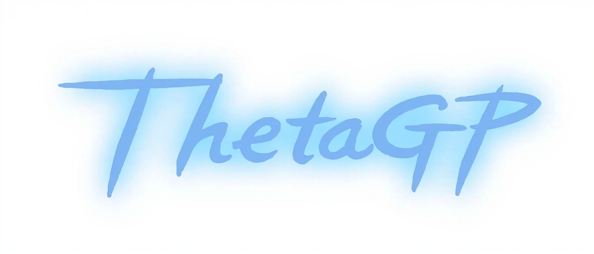

# ThetaGP.PB

<p align="center">
  
</p>

The ThetaGP protocol: one schema (`ThetaGP.proto`) from which the firmware's
codec and the host bindings are both generated. This repository is the schema,
its field bounds, this README and a generator; it knows no consumer.

## Layout

```
ThetaGP.proto     the schema the host and the device speak
ThetaGP.options   nanopb field bounds
Link.proto        the schema the two boards speak to each other
Link.options      its nanopb field bounds
generate.py       the generator
README.md
LICENSE           GPL-3.0
```

## Generate

```
generate.py c --nanopb <checkout> --out <dir>   # the C codec
generate.py c --schema protocol/Link.proto ...   # the boards' own codec
generate.py python --out <dir>                   # the Python bindings
```

`c` writes the codec of one schema; a consumer that compiles more than one
runs it once per schema, and `--schema` names the one (`protocol/ThetaGP.proto`
when it is left out).

`c` runs `protoc` and the nanopb generator at
`<checkout>/generator/nanopb_generator.py`; the checkout is the consumer's,
because the generated header and the runtime must match. `python` runs
`protoc --python_out`. Both need `protoc` and a python-protobuf runtime
(`$PROTOBUF_PYTHONPATH` points an interpreter that cannot import it).

## The wire

```
varint length | payload | payload checksum (low 16 bits, little endian)
```

The length covers the payload only; the checksum covers the payload only. A
payload is at most 1,024 B, so a frame is at most 1,028 B. A host numbers its
frames through `queued`: the reply carries request+1 and the host's next frame
carries reply+1.

## The two boards

`Link.proto` is the schema the panel board and the main board speak to each
other: the two greetings, the main board's state, the panel's beat, and one
navigation step. It is not the host's, and the host never sees it — the main
board translates, and only the `coproc` domain of `ThetaGP.proto` carries any of
it outward.

| Host arm | What it asks | Board message |
|---|---|---|
| `coproc.get_state` | What the panel is and what is on its screen | the last `Beat` this board kept |
| `coproc.nav` | One navigation step | `Nav`, which the panel answers in its next `Beat` |

The page numbers a host reads and writes (`CoprocPage`) are the panel's own, so
a `coproc_state` after a `coproc_nav` says exactly what the screen says. A step
is not acknowledged on the wire: the panel applies it, and the next beat is the
whole answer.

## Rules

- Arm numbers run dense from 1 within each `oneof`, assigned once, never reused;
  a removed field leaves `reserved N;`.
- A main arm is `<domain>_<command>`; a name appears in its `oneof` once.
- A field a device may not always send is `optional`.
- An arm a device does not answer is `ERR_UNKNOWN_CMD`; one it cannot do is an
  `Error` naming why.
- Additive only: what has shipped keeps its meaning.
- The protocol does not know the codebase: no consumer paths, no citations.

## Adding a command

Declare the request and reply messages; give the request arm the next free
number of its domain and the reply arm the k+2 relation; bound every string,
bytes and repeated field in `ThetaGP.options`; regenerate.
